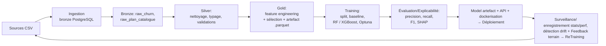
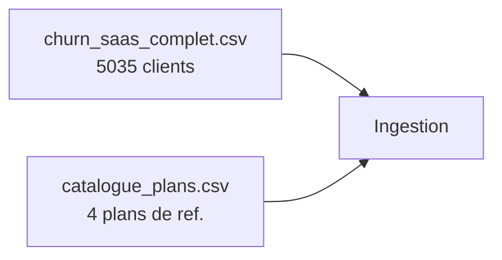
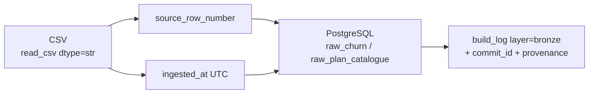
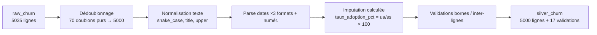
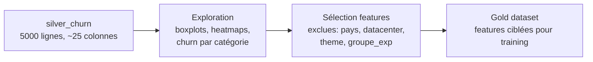
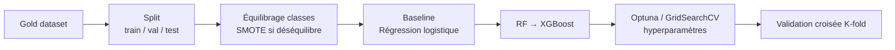
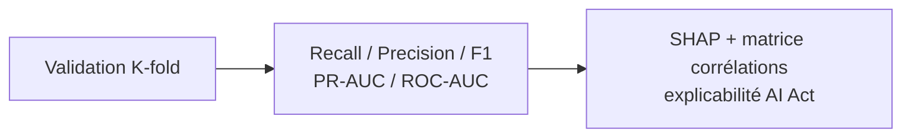
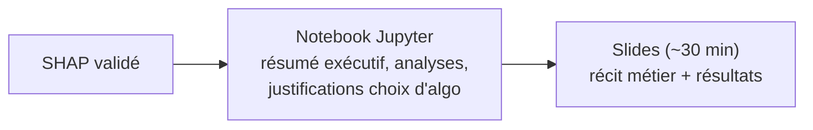
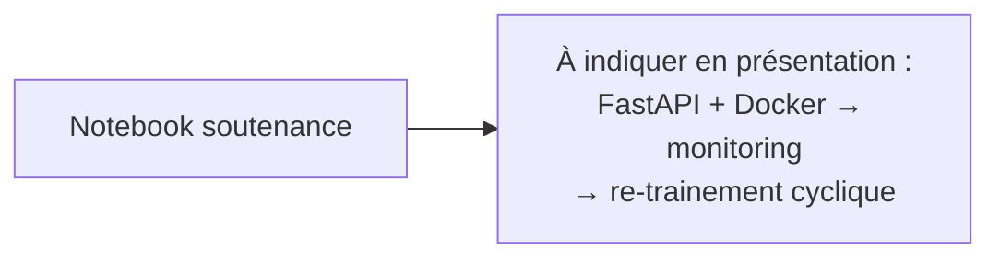

# Churn SaaS — Prédiction de résiliation client (Churn)

## Pipeline MLOps complet

---

### 1. Sources de données

Deux fichiers CSV bruts fournis par le « client » dans `sujet/` :

| Source | Lignes | Contenu |
|---|---|---|
| `churn_saas_complet.csv` | 5035 | Données clients SaaS (usage, support, satisfaction, churn) |
| `catalogue_plans.csv` | 4 | Référence des plans (starter, pro, business, enterprise) |

---

### 2. Ingestion vers Bronze

Les CSV sont lus en texte brut (`dtype=str`), enrichis d'un numéro de ligne source et d'un horodatage UTC, puis écrits dans PostgreSQL via SQLAlchemy.

---

### 3. Bronze vers Silver — Nettoyage, typage et validations

La couche silver [déduit le code source](src/churn/silver.py) :

- **Dédoublonnage** : validation que les `client_id` dupliqués sont identiques sur toutes les colonnes → 70 doublons purs validés, 5 035 → 5 000 lignes.
- **Normalisation texte** : `plan` → `plan_normalized` (snake_case, vérifié contre le catalogue), `secteur` (title case, « n/a » si manquant), `taille_entreprise` (upper case), `pays` (strip).
- **Parsing dates** : trois formats supportés (`YYYY-MM-DD`, `DD/MM/YYYY`, `DD Mon YYYY`) + vérification de concordance 100 % avec `jour_souscription`.
- **Typage numérique** : nettoyage des séparateurs (virgule/point) et suffixes (`€`, `%`, `h`), conversion en `Int64` / `float64`.
- **Imputation** : `taux_adoption_pct` calculé depuis `utilisateurs_actifs / sieges_souscrits × 100`, `nb_integrations` à 0, `delai_reponse_support_h` à 0, `commentaire_csm` à « n/a ».
- **Validations inter-lignes** : `utilisateurs_actifs ≤ sieges_souscrits`, `fonctionnalites_utilisees ≤ fonctionnalites_total`, `csat ∈ [1,5]`, `sante_compte_fin_periode ∈ [0,100]`.

---

### 4. Exploration et sélection des features (vers Gold)

Le notebook [churn_saas_certification.ipynb](churn_saas_certification.ipynb) réalise l'exploration pour décider quelles features intégrer au gold dataset :

| Feature | Décision | Justification |
|---|---|---|
| `pays` | Exclue | V de Cramér ≈ 0 — aucun lien avec le churn |
| `code_datacenter`, `groupe_experimentation`, `couleur_theme_interface` | Exclues | Aucun signal de corrélation |
| `jour_souscription`, `date_souscription` | Exclues du gold (présents en silver uniquement) | Redondant / bruit |
| `plan_normalized` | Conservée | 4 plans, CA réparti — lien fort avec churn |
| `taille_entreprise` | Conservée | Corrélation forte avec plan et sièges souscrits |
| `csat` | Conservée | Signal clair : satisfaction faible → churn élevé |
| `delai_reponse_support_h`, `tickets_support_90j` | Conservées | Délai support long → churn, surtout plans starter/pro |
| `commentaire_csm` | Conservée (catégoriel) | « Usage en forte baisse ce trimestre » est au-dessus du taux de churn moyen (28 %) |
| `heures_usage_30j`, `connexions_30j` | Conservées | Clients partis = moins d'usage / connexions |
| `revenu_mensuel_recurrent_eur` | Cible secondaire | Valeur vie client, pas feature d'entrée |

---

### 5. Training — Scikit-learn / MLFlow / Optuna

Classification binaire (churn Oui/Non) avec approche incrémentale :

1. **Baseline** : Régression logistique pour poser le premier chiffre.
2. **Modèles candidats** : Random Forest (arbre + vote majoritaire), XGBoost (gradient boosting).
3. **Hyperparamètres** : GridSearchCV (combinatoire exhaustive) ou Optuna (recherche bayésienne, affine progressivement).
4. **Équilibrage** : SMOTE pour la classe minoritaire (si déséquilibre churn).
5. **Validation croisée K-fold** pour une évaluation fiable.

Split train / validation / test — split temporel si les données sont ordonnées, sinon stratifié sur `churn`. Attention au data-leakage : l'imputation (médiane, ratio) ne doit pas s'exécuter sur l'ensemble du dataset avant le split.

---

### 6. Évaluation et explicabilité

Métriques prioritaires (l'accuracy est inutile sur un churn à ~28 %) :

| Métrique | Objectif métier |
|---|---|
| **Recall** | Détecter un maximum de futurs churners (faux négatif = perdre un client sans alerte) |
| **Precision** | Éviter les fausses alarmes qui gaspillent le temps des CSM |
| **F1 score** | Arbitrage entre recall et precision |
| **PR-AUC, ROC-AUC** | Qualité globale du classifieur |

Explicabilité : SHAP pour montrer quelles features ont conduit à la prédiction de churn (obligation AI Act). Matrice de corrélation features vs target pour vérifier qu'aucune feature ne « fuit » la réponse.

---

### 7. Résultats et documentation

Le notebook Jupyter est la pièce centrale de la soutenance : il raconte le cheminement de données brutes au modèle, avec les markdowns expliquant les choix (plus important que le code). Il doit être rendu « joué » — le jury ne le relancera pas.

---

### 8. Déploiement et monitoring (hors scope du labo — à indiquer)

Pour passer en production : conteneurisation Docker, API FastAPI avec contrat Pydantic, logging des prédictions/inputs/timings/version modèle. Monitoring Grafana/Prometheus pour drift PSI et feedback terrain HITL.

